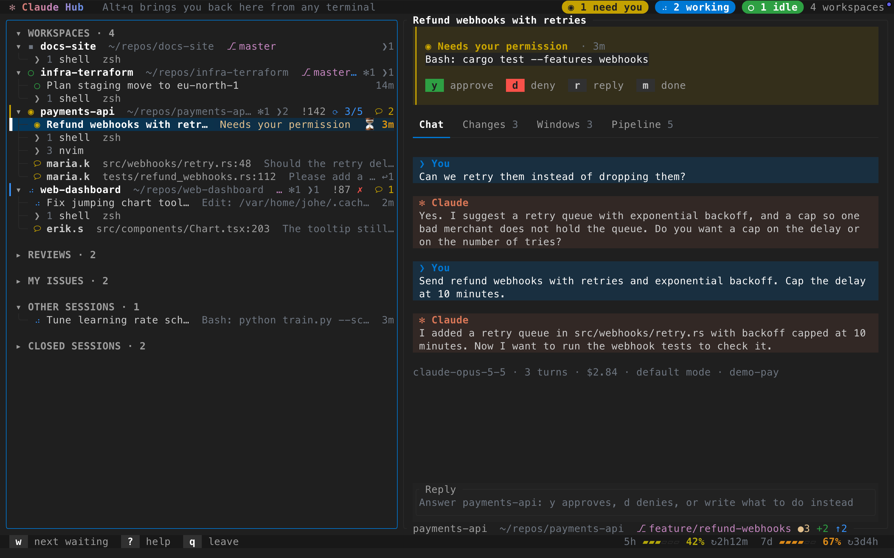

# Agents Hub

One place for your Claude Code sessions and the terminals around them.



The hub lists your **workspaces**, the ones that need you first. A workspace is a directory
with its Claude sessions, shells and editors. Under each workspace you see its **agents**
(every running Claude session, titled by its task, with status and what it does right now)
and its terminals. The panel next to the list shows what the selected agent waits for, its
last message, the changed files and the terminals in the workspace.

The directory does not have to be a git repo; when it is, the hub shows branch, changes and
ahead/behind.

The panel follows the selected row. A workspace shows what is open in it. An agent shows what
it waits for, your last request and its last reply. A terminal shows its screen. Terminal
previews are rendered in color: the hub streams each terminal's
output to `~/.local/state/claude-hub/screens/` and replays it, because `tmux capture-pane`
crashes some tmux builds. A terminal opened before the hub started piping it shows its
screen from the next output on.

Work keeps running when you leave. Close the terminal, come back later, run
`claude-hub` again and everything is where you left it. Under the hood claude-hub
runs a private tmux server (`tmux -L claude-hub`), so you never have to deal with tmux
yourself.

## Install

Requires Linux (the hub reads `/proc`), tmux, Rust (cargo) and Claude Code. `e` opens
nvim, so install it if you want that key.

```sh
cargo install --path .
```

This puts `claude-hub` in `~/.cargo/bin`. Run `cargo install --path .` again after
pulling changes; the next `claude-hub` restarts the hub UI on the new binary.

### Install the hooks

The hub gets the status of each agent from Claude Code hooks:

```sh
claude-hub install-hooks
```

This adds `claude-hub report` to the hooks in `~/.claude/settings.json`. It replaces
older claude-hub hooks, including the `hook.sh` of the Python version. The command shows what it
changes and asks first. It saves a backup as `settings.json.bak`.

The hook runs on every Claude tool call, so it does almost nothing: it stores the latest
event per session (about 3 ms) and the hub picks it up at once.

Only Claude sessions started after this report status.

The command also sets `claude-hub statusline` as the Claude Code status line, if you have
none. Claude Code passes your plan usage only to the status line. The hub then shows the
5-hour and weekly limits at the bottom right, with the time until each resets. This needs
a claude.ai subscription, and the numbers come after the first reply in any session. If you
already have a status line, it stays; send its JSON input to `claude-hub statusline` too.

## Configure (optional)

`~/.config/claude-hub/config.toml`:

```toml
roots = ["~/repos"]          # where to look for git repos (any depth)
mouse = true
refresh_seconds = 2
stale_minutes = 60
prewarm = true               # keep a started shell ready per workspace
hub_key = "M-q"              # tmux key that brings you back to the hub from any terminal
theme = "dark-modern"        # dark-modern, light, catppuccin, gruvbox, tokyo-night
```

All keys are optional. The default for `roots` is `~/repos`.

## Run

```sh
claude-hub
```

This starts the hub, or reconnects to it if it already runs. Press `n` to open your
first workspace.

Like `goto`, it also takes an argument:

```sh
claude-hub .              # open a workspace for this directory (or jump to it)
claude-hub claude tui     # open the hub with the picker searching for "claude tui"
```

In the picker (`n`):

- Type words to fuzzy search repos, directories and recent places.
- Type a path (`~/`, `/`, `./`) to browse directories like in a shell. `Tab` completes
  the selected directory and lists what is inside it. `→` accepts the grey suggestion.
- `Enter` opens it (a new workspace starts with a terminal), `Ctrl+O` starts Claude instead.

The directory list is cached in `~/.cache/claude-hub/dirs.tsv`. Press `Ctrl+R` in the
picker after you clone a new repo.

| Where | Key | Action |
|---|---|---|
| Anywhere | `Alt+Q` or click **◀ Claude Hub** | Back to the hub |
| Hub | `j` / `k` or `↓` / `↑` | Move down / up |
| Hub | `g` / `G`, `Ctrl+B` / `Ctrl+F` | First / last row, page up / down |
| Hub | `Enter` | Go to the agent, the terminal or the workspace |
| Hub | `n` | Open a workspace: fuzzy search or type a path |
| Hub | `c` / `t` / `e` | New Claude / terminal / nvim in the workspace |
| Hub | `x` | Close the agent or the workspace |
| Hub | `R` | Rename the workspace |
| Hub | `r` | Reply: type a message, `Enter` sends it to the agent |
| Hub | `y` / `d` | Approve / deny a permission prompt |
| Hub | `Space` or click `▸`/`▾` | Fold or unfold the workspace. Agents that wait for you still show |
| Hub | `m` | Mark the agent as done, so it stops showing as waiting |
| Hub | `a` | Adopt an agent that runs outside the hub |
| Hub | `w` | Jump to the next agent waiting for you |
| Hub | `h` `l` / `←` `→` / `Tab` or `1`–`4` | Switch the tab in the detail panel |
| Thread | `Enter` / `r` / `f` | Open in GitLab / reply in the thread / put it in Claude's prompt |
| Thread | `v` | Resolve the thread, posting an optional reply first (pre-filled with `Fixed in <commit>.`) |
| Hub | `p` | Push the workspace's branch; opens a draft merge request when it has none |
| Hub | `PgUp` / `PgDn` | Scroll the detail panel |
| Hub | `/` | Filter, `Esc` clears |
| Hub | `?` | Help |
| Hub | `q` | Leave. Everything keeps running |

Inside a workspace, the bar at the top shows where you are: a **◀ Claude Hub** button (click it
or press `Alt+Q` to go back), the workspace name and path, its windows (click to switch) and
how many Claude sessions wait for you.

Opening a directory that already has a workspace jumps to it instead of creating a
second one.

`Enter` on an agent takes you to it: plain Claude Code in its terminal. `Alt+Q` brings you
back. Alt+Q is free in Claude Code and nvim, and it is easy to reach with the left hand. (In zsh it shadows `push-line`.) `Esc` cannot do that job: Claude, nvim and the shell all use it themselves.

Quick answers do not need the trip. Press `r`, type a message and press `Enter`: the hub types
it into the agent's terminal for you. When an agent asks for permission, `y` approves and `d`
denies, and the panel shows the tool call it wants to run.

**Merge requests.** When a workspace's branch has a GitLab merge request, its row shows
`!140 ✓  2`: the MR, its pipeline (✓ passed, ✗ failed, ⟳ running) and its unresolved review
threads. Each thread is listed under the workspace. Select one to read it, `r` to reply in
GitLab, `f` to put it in the workspace's Claude prompt and jump there (edit it, then `Enter` sends), `Enter` to open it in the browser. This
uses `glab`, so run `glab auth login` once. MR data refreshes every minute in the background,
every 10 seconds while a pipeline runs. `Ctrl+R` on a workspace fetches it right away.

To close the loop: `f` sends a comment to Claude, `p` pushes the fix (and opens a draft MR the
first time), `v` resolves the thread with a "Fixed in <commit>" reply you can edit. The **Pipeline** tab (`4`) shows each stage and job
with its status and duration.

**Reviewing others' merge requests.** MRs where you are a requested reviewer are listed under
**TO REVIEW**, newest activity first, with author, pipeline and open threads. The panel shows the
description, threads, approvals and pipeline. `Enter` opens the MR in GitLab. `c` checks out its
code in a separate git worktree of your local clone (under `~/.cache/claude-hub/reviews/`),
opens it as a workspace and starts Claude with a review prompt typed in but not sent: adjust it,
then press `Enter`. Your own checkout is never touched. `x` on a review workspace closes it and
deletes the checkout. The list refreshes every two minutes; `Ctrl+R` on it refreshes now.
The list is fetched outside any repo, so `glab` asks its default host. If your GitLab is not
gitlab.com, set it once, or the list stays empty: `glab config set --global host git.example.com`.

Links in the panel (the `!140` line of an MR, "Open the thread in GitLab") are real terminal
hyperlinks: Ctrl+click (Cmd+click on macOS) opens them in the browser of the computer you sit
at, also over SSH.

Claude sessions that run outside claude-hub are listed too, marked *outside hub*. The hub
shows their status and messages and can reply to them, but cannot jump to them. Press `a`
to adopt one: the hub stops the process and resumes the session with `claude --resume` in
a new window of the workspace for its directory.

Mouse: a click selects a row. A second click on the selected row (or a double-click)
opens it. Click a terminal in the detail panel to jump to it.

The title of an agent comes from its transcript: the title Claude Code gives the session,
or the first prompt until then. The last message, the last request, the model and the
cost come from the same file.

## Notes

- The hub's tmux server loads your own `~/.tmux.conf` first, so your prefix and key
  bindings work. The hub then sets its own status bar and mouse settings on top.
- Running `claude-hub` restarts the hub UI when the binary has changed since it started.
- New terminals open instantly because the hub keeps one started shell per workspace in
  a hidden `_pool` session, and starts one for the directory you highlight in the picker.
  Turn it off with `prewarm = false`.
- `claude-hub ui` runs only the hub UI in the current terminal, without the tmux engine.
- To stop everything: `tmux -L claude-hub kill-server`.

## Release

`scripts/release.sh 0.6.0` sets the version in `Cargo.toml`, commits and tags.
Then push with `git push origin master 0.6.0`.
